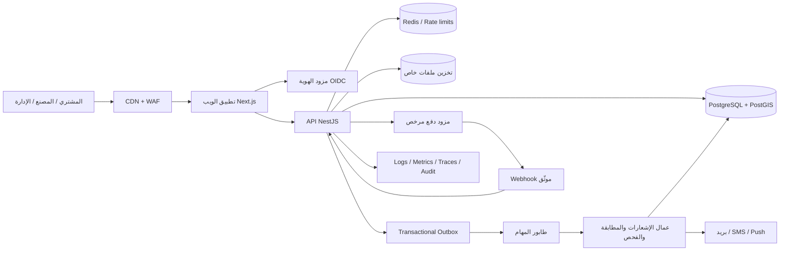
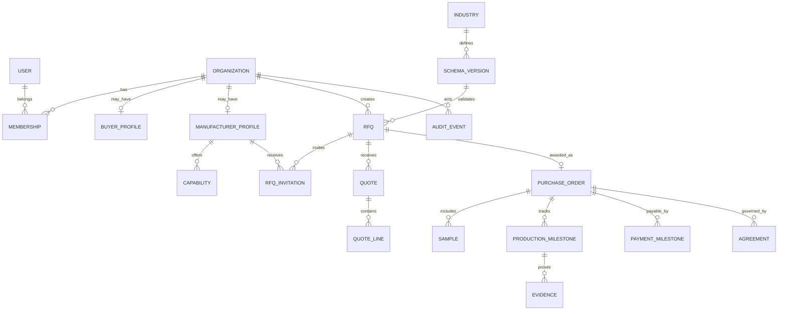

# مواصفات منصة سوقي للتصنيع التعاقدي بين الشركات

> **نوع الوثيقة:** تصور معماري ومواصفات تنفيذ لمنصة ويب مستقلة متعددة القطاعات.  
> **الحالة:** مقترح قابل للتحويل إلى خطة تنفيذ بعد حسم الأسواق والبلدان ومزودي الدفع والاشتراطات القانونية.  
> **حدود النطاق:** هذه الوثيقة لا تعني أن المنصة أو واجهاتها الخلفية قد نُفذت في تطبيق Expo الحالي. التطبيق الحالي نموذج جوّال منفصل ببيانات محلية، كما هو موضح في [README.md](../README.md).

## 1. الملخص التنفيذي

تربط المنصة العلامات التجارية والمشترين بمصانع جرى التحقق منها، وتدير دورة التوريد من نشر طلب عروض الأسعار (RFQ) إلى اختيار العرض، اعتماد العينة، الإنتاج، الفحص، وتسوية الدفعات المرحلية. يجب أن تدعم القطاعات المختلفة عبر نموذج بيانات ثابت للعمليات المشتركة ومخططات حقول قطاعية مُصدّرة بالإصدارات؛ لا عبر إنشاء نموذج وقاعدة بيانات منفصلين لكل صناعة.

**مبادئ التصميم**

1. ابدأ بتطبيق خلفي معياري واحد (Modular Monolith) وحدود وحدات واضحة، ثم افصل الخدمات عند وجود مبرر تشغيلي أو حمل مثبت.
2. افصل المؤسسة عن المستخدم؛ قد ينتمي المستخدم إلى عدة مؤسسات وبأدوار مختلفة.
3. ثبّت نسخة مخطط القطاع ونسخة متطلبات RFQ عند النشر حتى تبقى الطلبات والعروض قابلة للتفسير بعد تحديث النماذج.
4. اجعل الحالات والمدفوعات والعقود قابلة للتدقيق؛ لا تعتمد على تعديل سجل الحالة الحالي وحده.
5. استخدم مزود دفع مرخصاً يدعم المدفوعات السوقية/المقسمة والحجز أو آلية مماثلة قانونياً. لا تحتفظ المنصة بأموال العملاء بنفسها قبل مراجعة تنظيمية.
6. اجعل المطابقة قابلة للتفسير، مع موافقة بشرية في الاختيار والتعاقد، ولا تصف ترتيباً إرشادياً بأنه ضمان جودة أو نتيجة ذكاء اصطناعي.

## 2. الأدوار وحدود الوصول

| الدور | نطاق الوصول الأساسي | أمثلة للصلاحيات |
|---|---|---|
| مشتري / مدير علامة تجارية | مؤسسات المشتري وطلبات التوريد التابعة لها | إنشاء RFQ، دعوة مصانع، مقارنة عروض، إدارة عينات وطلبات |
| عضو مشتري | ما تسمح به عضويته | إعداد RFQ أو متابعة الطلب أو قراءة المحادثات |
| مصنع / مسؤول مؤسسة | ملف المصنع وعضويات المؤسسة وطلبات الدعوة | تحديث القدرات والطاقة، إرسال العروض، إدارة الإنتاج |
| مسؤول جودة المصنع | الطلبات والمهام المسندة إليه | رفع تقارير الفحص والأدلة وطلب اعتمادها |
| مدير المنصة | عمليات المنصة وفق أقل صلاحية لازمة | مراجعة التحقق، إدارة النزاعات والرسوم، تعليق الحسابات |
| مدقق / دعم | سجلات أو حالات مسندة ومحدودة | قراءة الأدلة وسجل التدقيق دون صلاحية مالية افتراضية |

تُطبّق الصلاحيات على مستوى **المؤسسة + المورد + المورد/الطلب** في الخادم، لا بمجرد إخفاء أزرار الواجهة. تتطلب الإجراءات الحساسة مثل تغيير الحساب البنكي أو اعتماد صرف دفعة إعادة تحقق وتسجيل تدقيق.

## 3. المعمارية التقنية والبنية التحتية

### 3.1 الحزمة المقترحة

| الطبقة | الاختيار المقترح | سبب الاختيار / ملاحظات |
|---|---|---|
| الويب | Next.js + React + TypeScript | صفحات عامة مفهرسة وواجهات لوحات تحكم؛ مكونات مشتركة وتصميم RTL. حدّد استراتيجية العرض لكل مسار، ولا تجعل بيانات التوريد الخاصة قابلة للتخزين المؤقت العام. |
| تصميم الواجهة | مكتبة مكونات داخلية فوق CSS logical properties، مع دعم RTL وWCAG | تجنب ربط اتجاه الواجهة بـ `left/right` الثابتين؛ وفّر حالات تحميل وفراغ وخطأ واستجابة للوحة المفاتيح. |
| API | NestJS + TypeScript، REST موثق بـ OpenAPI | وحدات نطاق واضحة، تحقق DTO، حراسة صلاحيات، وسهولة فصل وحدات ذات حمل مرتفع لاحقاً. |
| قاعدة البيانات | PostgreSQL مُدار + PostGIS + Prisma أو SQL migrations مُراجعة | معاملات موثوقة، علاقات، JSONB لمتطلبات القطاعات، وفهارس مكانية لمواقع المصانع. استخدم SQL عند الحاجة لقيود أو عمليات PostGIS لا يغطيها ORM مباشرة. |
| التخزين المؤقت والمهام | Redis للمهام القصيرة ومحددات المعدل؛ Queue مُدارة مثل SQS أو RabbitMQ للمهام غير المتزامنة | لا تجعل Redis مصدر الحقيقة للطلبات أو الدفعات. استخدم نمط Outbox لمنع فقد أحداث قاعدة البيانات عند النشر. |
| الملفات | تخزين كائنات خاص متوافق مع S3، بروابط موقعة قصيرة العمر | للرسومات والعقود والعينات والصور؛ افحص الملفات، سجّل بصمتها، وطبّق سياسة احتفاظ وصلاحيات وصول. |
| البحث | PostgreSQL Full Text كبداية؛ OpenSearch عند الحاجة إلى بحث متعدد اللغات/مرشحات واسعة | لا تضف محرك بحث منفصلاً قبل قياس الاحتياج. |
| الهوية | مزود OIDC مُدار أو خدمة هوية مؤسسية، مع MFA للأدوار الحساسة | لا تخزّن كلمات المرور أو أسرار الدفع في التطبيق؛ دعم SSO للمؤسسات مرحلة لاحقة. |
| التشغيل | حاويات على خدمة مُدارة (مثل ECS/Fargate)، قاعدة بيانات مُدارة، CDN/WAF، أسرار مُدارة | المنصة السحابية النهائية تتحدد حسب بلد التشغيل ومتطلبات إقامة البيانات والتكلفة. |
| المراقبة | سجلات منظمة، تتبع موزع، مقاييس وتنبيهات، وأثر تدقيق منفصل | تنقيح البيانات الشخصية والتجارية الحساسة من السجلات. |
| النشر | CI/CD مع فحوصات واختبارات وهجرات مراجعة؛ IaC مثل Terraform | بيئات منفصلة للتطوير والاختبار والإنتاج، نشر تدريجي وخطة رجوع متوافقة مع الهجرات. |

هذه اختيارات مرجعية وليست إلزاماً بمزود سحابي أو إصدار بعينه. تُراجع الإصدارات المدعومة والتوافق عند بدء التنفيذ.

### 3.2 مخطط مكونات عالي المستوى



### 3.3 حدود وحدات الخادم

ابدأ بوحدات نطاقية داخل نشر خلفي واحد:

1. **Identity & Organizations:** المستخدمون، المؤسسات، العضويات، الدعوات، الأدوار.
2. **Manufacturer Directory:** الملف العام، القدرات، الشهادات، الطاقة، التحقق.
3. **RFQ & Schema Registry:** تعريفات القطاعات، إصدارات المخططات، الطلبات، المرفقات.
4. **Matching & Invitations:** شروط الأهلية، ترتيب المرشحين، الدعوات، أسباب المطابقة.
5. **Quoting & Sourcing:** العروض، البنود، الاستفسارات، المقارنة، الترسية.
6. **Samples & Production:** العينات، أوامر الشراء، المراحل، الأدلة والفحص.
7. **Contracts & Messaging:** الاتفاقيات، نسخ الوثائق، التواقيع، المحادثات.
8. **Payments & Disputes:** تعليمات الدفع، Webhooks، الأقساط، الاسترداد والنزاع.
9. **Administration & Audit:** مراجعة الجودة، الرسوم، الإجراءات الإدارية وسجل التدقيق.

لا تبدأ بخدمات مصغرة لكل وحدة. افصل وحدة فقط عندما تدعمها مؤشرات قياس واضحة مثل حمل مستقل، متطلبات نشر/امتثال منفصلة، أو فريق يملكها مستقلاً.

## 4. نمذجة البيانات وطلبات RFQ الديناميكية

### 4.1 الاستراتيجية

يتكون كل RFQ من:

- **حقول مشتركة مُطبّعة:** المشتري، القطاع، الكمية، العملة، البلد/وجهة الشحن، الموعد المطلوب، حالة الطلب.
- **متطلبات قطاعية JSONB:** تفاصيل تختلف بين الصناعات، مخزنة مع معرف إصدار مخطط ثابت.
- **حقول معيارية مفهرسة للمطابقة:** نسخ مُتحقق منها من السمات التي يحتاجها البحث والترشيح، مثل نوع العملية، MOQ، المادة، الطاقة أو الموقع. لا تستخرج هذه القيم تخميناً من JSON وقت كل بحث.
- **مرفقات وإصدارات:** ملفات رسومات أو صور أو مواصفات خاصة، مع وصول محدود وسجل نسخ.

يُحفظ تعريف كل نموذج كإصدار غير قابل للتعديل بعد نشره، مع `schema_json` متوافق مع JSON Schema أو مخطط داخلي مكافئ، وقائمة حقول آمنة للعرض. تُتحقق البيانات في العميل لتحسين التجربة، ويعيد الخادم التحقق من الإصدار نفسه قبل حفظ الطلب. عند تحديث الصناعة، يُنشأ إصدار جديد؛ لا يعاد تفسير RFQ منشور بمخطط أحدث.

**تجنب** جدول EAV عام لكل خاصية، أو أعمدة مخصصة لكل صناعة في جدول RFQ، أو استخدام JSONB وحده لكل شيء. الأول يصعّب الاستعلام والقيود، والثاني يسبب تضخماً وتغييرات متكررة، والثالث يضعف الفهرسة والتحقق الدقيق.

### 4.2 مخطط علاقات مفاهيمي



### 4.3 جداول/كيانات أساسية

| الكيان | الحقول الرئيسية المقترحة | ملاحظات تنفيذ |
|---|---|---|
| `users` | `id`, `identity_subject`, `email`, `phone`, `status`, `created_at` | هوية المزود الخارجي مرجعية؛ لا تخزّن بيانات اعتماد OIDC. |
| `organizations` | `id`, `type`, `legal_name`, `display_name`, `country_code`, `status` | لا تفترض أن المستخدم = مؤسسة؛ يمكن للمؤسسة أن تعمل كمشتري ومصنع إذا سمح نموذج الأعمال. |
| `memberships` | `organization_id`, `user_id`, `role`, `status`, `invited_at` | قيد فريد للمؤسسة والمستخدم، وصلاحيات مرتبطة بالمؤسسة. |
| `manufacturer_profiles` | `organization_id`, `verification_status`, `location`، بيانات اتصال، `public_profile` | نقطة PostGIS `geography(Point,4326)` وفهرس GiST؛ لا تعرض العنوان الدقيق علناً افتراضياً. |
| `capabilities` | المصنع، `industry_id`, `process_code`, `materials`, `min_order_qty`, `max_order_qty`, `capacity_value`, `capacity_unit`, `lead_time_days` | وحدات قياس موحدة وقواميس مُدارة؛ سجل الطاقة وتاريخ سريانها ومصدرها. |
| `verification_cases` | المصنع، `status`, `reviewer_id`, `checklist_version`, `decision_at` | فصل قرار التحقق عن ملف المصنع، وإرفاق نتائج التدقيق بطريقة مقيدة. |
| `industries` | `id`, `code`, `name`, `active` | أسماء وعناوين مترجمة عند الحاجة. |
| `industry_schema_versions` | `id`, `industry_id`, `version`, `schema_json`, `published_at`, `retired_at` | نسخة منشورة غير قابلة للتعديل؛ قيد فريد للقطاع والإصدار. |
| `rfqs` | `id`, `buyer_org_id`, `industry_id`, `schema_version_id`, `status`, `quantity`, `unit`, `target_date`, `currency`, `destination`, `requirements_json`, `published_at` | يحوي الحقول العامة المطبّعة بالإضافة إلى JSONB متحقق. |
| `rfq_search_attributes` | `rfq_id`, `attribute_code`, `value_*` أو أعمدة معيارية مناسبة | اختياري عند تعدد سمات البحث؛ يجب أن تكون القيم مشتقة ومتحققاً منها وفق قاموس السمات. |
| `rfq_invitations` | `rfq_id`, `manufacturer_org_id`, `status`, `sent_at`, `responded_at`, `match_snapshot` | سجل سبب الترشيح والدرجة وقت الدعوة؛ لا تُكشف بيانات منافسين. |
| `quotes` / `quote_lines` | `rfq_id`, `manufacturer_org_id`, `revision`, `status`, `valid_until`, `currency`, `unit_price`, `setup_cost`, `lead_time`, بنود السعر والملاحظات | كل تعديل عرض ينشئ مراجعة، لا يمحو العرض السابق. استخدم `NUMERIC` للعملات وكميات الدقة المطلوبة، لا `float`. |
| `purchase_orders` | `rfq_id`, `quote_id`, `buyer_org_id`, `manufacturer_org_id`, `status`, `currency`, `agreed_terms_snapshot` | سجل تعاقدي ثابت يشير للعرض المعتمد ويحتفظ بلقطة الشروط. |
| `samples` | `purchase_order_id`, `type`, `status`, `tracking_reference`, `review_notes`, `approved_at` | تشمل طلب العينة وإصداراتها وقرار المشتري. |
| `production_milestones` | `purchase_order_id`, `code`, `sequence`, `status`, `planned_at`, `completed_at` | انتقالات الحالات مسموحة بقواعد واضحة؛ حفظ سجل أحداث منفصل لكل انتقال. |
| `evidence_files` | `owner_org_id`, `object_key`, `checksum`, `mime_type`, `size`, `classification`, `scan_status` | التخزين خاص؛ يتحقق الخادم من النوع والحجم والملكية. لا تحفظ الملف نفسه في DB. |
| `payment_milestones` | `purchase_order_id`, `sequence`, `amount`, `currency`, `condition`, `status`, `provider_reference` | تتبع تعليمات المزود فقط؛ مصدر الحقيقة لحالة التحصيل/الصرف هو دفتر أحداث الدفع والتحقق من المزود. |
| `agreements` | `purchase_order_id`, `type`, `template_version`, `document_version`, `status`, `content_hash` | يُحفظ المستند الموقع ونسخته والبصمة وأطراف التوقيع وفق المتطلبات القانونية. |
| `messages` | `thread_id`, `sender_org_id`, `body`, `created_at`, `visibility` | تُربط المحادثة بـ RFQ أو PO، وتُراجع صلاحية كل قراءة ورفع. |
| `disputes` | `purchase_order_id`, `opened_by`, `reason_code`, `status`, `resolution`, `resolved_by` | فصل ملف النزاع والأدلة عن حقول الطلب القابلة للتعديل. |
| `audit_events` | `actor_id`, `organization_id`, `action`, `resource_type`, `resource_id`, `metadata_redacted`, `created_at` | إضافة فقط (append-only)، مع تنقيح الأسرار والبيانات غير اللازمة. |
| `outbox_events` | `id`, `aggregate_type`, `aggregate_id`, `event_type`, `payload`, `created_at`, `published_at` | يكتب ضمن معاملة تغيير المجال؛ عامل يعيد المحاولة بطريقة idempotent. |

**ضوابط قاعدة البيانات:** مفاتيح UUID، أوقات UTC، مبالغ بالعملة مع رمز ISO 4217، قيود `CHECK` للمبالغ والكميات والحالات، مفاتيح خارجية، فهارس بحسب استعلامات قائمة المستخدم، وفصل منطقي للبيانات عبر `organization_id`. طبّق Row-Level Security كطبقة دفاع إضافية بعد اختبارها مع اتصالات التطبيق وعمليات الدعم. لا تعتبر RLS بديلاً عن فحوص الصلاحية في API.

## 5. تجربة المستخدم ولوحات التحكم

### 5.1 مسارات عامة مشتركة

1. تسجيل الدخول أو إنشاء حساب والتحقق من البريد/الهاتف.
2. اختيار إنشاء مؤسسة مشتري أو مصنع، أو قبول دعوة إلى مؤسسة قائمة.
3. إكمال ملف المؤسسة والبلد واللغة والمنطقة الزمنية والعملات المفضلة.
4. إظهار مسار إرشادي واضح؛ لا تُظهر للمصنع شارة "متحقق" قبل اكتمال القرار البشري.
5. توفير إشعارات داخل التطبيق وبريدية، مع تفضيلات وتسجيل حالة الإرسال.

### 5.2 لوحة المشتري

1. **نظرة عامة:** RFQs المفتوحة، عروض جديدة، موافقات عينات معلقة، أوامر إنتاج ومواعيد متأخرة.
2. **إنشاء RFQ:** اختيار القطاع، تحميل رسم/مرجع، تعبئة الحقول المشتركة، ثم نموذج ديناميكي متحقق؛ حفظ مسودة واستئنافها.
3. **النشر والتوزيع:** مراجعة ملخص المتطلبات والسرية، اختيار دعوة تلقائية أو تحديد مصانع، وإظهار توقعات زمن الرد دون ضمان.
4. **مطابقة المصانع:** عرض أسباب المطابقة والفجوات، شارات التحقق ونطاقات الطاقة؛ لا تكشف بيانات حساسة عن مصنع غير مدعو.
5. **مقارنة العروض:** مقارنة السعر الإجمالي وتفصيله، MOQ، شروط الدفع، العينة، مدة الإنتاج، صلاحية العرض، والاستثناءات.
6. **إدارة العينة:** سجل الإصدارات، تعليقات المشتري، قرار قبول/رفض، وصور أو وثائق ذات وصول خاص.
7. **أمر التوريد:** موافقة العرض والشروط والاتفاقية، قائمة نقاط الدفع، ومنع إظهار "مدفوع/محجوز" قبل تأكيد مزود الدفع.
8. **تتبع الإنتاج:** خط زمني للمراحل، موعد مخطط مقابل فعلي، تقارير مصورة، طلبات تغيير، وسبب التأخير.
9. **التواصل:** محادثة مرتبطة بطلب أو أمر، إشعارات، ومرفقات بصلاحية محددة.
10. **النزاع والتقييم:** فتح نزاع بأسباب محددة وأدلة، متابعة القرار، وتقييم بعد اكتمال الطلب وفق سياسة المنصة.

### 5.3 لوحة المصنع

1. إكمال صفحة المصنع والقدرات والمواد والعمليات والطاقة ومواقع الإنتاج.
2. إرسال مستندات التحقق، متابعة حالة المراجعة، ومعرفة المطلوب لاستكمالها.
3. صندوق RFQs مناسب مع عوامل الترشيح، الموعد النهائي، ومستوى اكتمال الطلب.
4. قبول الاهتمام أو الاعتذار بسبب اختياري؛ لا يُكشف طلب غير مدعو إلا إذا قررت سياسة المنصة خلاف ذلك.
5. إنشاء عرض بمراجعات وبنود سعر واضحة وعملة وصلاحية وشروط تسليم/دفع، ثم إرساله وتتبّع حالته.
6. إدارة العينات وتحديث الشحنات والملاحظات، وطلب موافقة المشتري على نسخة محددة.
7. عرض أوامر الإنتاج الفائزة وتقويم الطاقة والالتزامات؛ لا يُعامل إدخال الطاقة كتأكيد آلي على القدرة.
8. نشر تحديثات الإنتاج ضمن المراحل المتفق عليها، مع رفع الأدلة، والاحتفاظ بسجل من أرسلها ومتى.
9. الاطلاع على الدفعات المتوقعة والحالات المؤكدة من مزود الدفع فقط، وتقديم مستندات الفوترة عند الحاجة.
10. طلب تغيير أو تمديد بموفقة الطرفين؛ لا تغيّر الشروط المتفق عليها بصمت.

### 5.4 لوحة مدير المنصة

1. قائمة طوابير مراجعة المصانع مع التحقق من الوثائق، قوائم التدقيق، وسجل القرارات.
2. مراجعة جودة العينات/الإنتاج كوسيط وفق الصلاحيات، مع تسجيل تضارب المصالح.
3. إدارة التصنيفات ومخططات القطاعات وإصداراتها دون كسر RFQs المنشورة.
4. إعداد العمولات والرسوم حسب السوق أو القطاع مع سجل نسخة وتاريخ سريان؛ لا تعاد كتابة رسوم اتفاق قائم.
5. لوحة تسوية تعرض حالة المزود والمبالغ المرجعية والفروقات، ولا تسمح بتعديل حالة دفع مؤكدة يدوياً دون مسار موثق.
6. إدارة النزاعات بتعيين مسؤول، جمع أدلة، تسجيل القرار وأسبابه، وآلية استئناف إن اعتمدت السياسة.
7. إدارة الحسابات والمحتوى والإبلاغات، مع أدوات تعليق/إعادة تفعيل محددة السبب ومراجعة لاحقة.
8. تقارير تشغيلية مجمعة؛ إخفاء البيانات التجارية الفردية عن من لا يحتاجها.

## 6. الميزات الأساسية

### 6.1 محرك المطابقة

**المرحلة الأولى: ترشيح أهلية حتمي**

استبعد المصنع إذا كان ملفه معلقاً/موقوفاً عندما تشترط السياسة التحقق، أو لا يعمل بالقطاع/العملية المطلوبة، أو لا يستطيع خدمة بلد الوجهة/الامتثال المعلن، أو كانت الكمية خارج نطاقه بشكل قطعي. تحقّق من حد MOQ والطاقة المتاحة وتاريخ تحديثها، مع اعتبار "غير معروف" قيمة غير مؤكدة لا تطابقاً ناجحاً.

**المرحلة الثانية: ترتيب قابل للتفسير**

مثال نقطة بداية قابلة للمعايرة، وليست ادعاءً بنتيجة دقيقة:

```text
score = 100 * (
  0.30 * capability_fit +
  0.20 * capacity_fit +
  0.15 * moq_fit +
  0.15 * lead_time_fit +
  0.10 * geography_fit +
  0.10 * verified_quality_fit
)
```

كل عامل يقع بين 0 و1 وله تعريف موثق. `capability_fit` يقيس العملية والمواد، `capacity_fit` مدى توافر الطاقة للكمية ضمن نافذة الإنتاج، `moq_fit` قرب الحد الأدنى من حجم الطلب، `lead_time_fit` توافق الموعد، `geography_fit` المسافة أو تكلفة الشحن التقريبية حين تتوفر بيانات سليمة، و`verified_quality_fit` اكتمال تحقق وشهادات سارية ملائمة لا مجرد شارة عامة. يمكن تخصيص أوزان القطاع، مع تسجيل نسخة إعدادات المحرك.

**قواعد الثقة والحوكمة**

1. اعرض أسباب الترشيح والعوامل الناقصة، لا الدرجة وحدها.
2. لا تستنتج جودة أو أهلية اعتماد من بلد المصنع أو سمات شخصية.
3. خزّن `algorithm_version` ولقطة بيانات العوامل وقت تقديم النتيجة لأغراض التفسير والتدقيق.
4. ابدأ بقواعد معلنة؛ لا تستخدم نموذج تعلم آلي قبل توفر بيانات موافقة قانونياً، ومقاييس تحيز ودقة، وإمكانية اعتراض ومراجعة بشرية.
5. حدّث الطاقة وتوفر المصنع بإقرار دوري، وقلل أثر المعلومات القديمة على الترتيب.

### 6.2 منشئ RFQ الديناميكي

مثال تعريف قطاع الملابس:

```json
{
  "industryCode": "apparel",
  "schemaVersion": 3,
  "fields": [
    { "key": "fabric", "type": "multiSelect", "required": true, "optionsRef": "textile_materials" },
    { "key": "sizeRange", "type": "sizeMatrix", "required": true },
    { "key": "colorCount", "type": "integer", "minimum": 1 },
    { "key": "branding", "type": "multiSelect", "options": ["label", "embroidery", "print"] }
  ]
}
```

مثال تعريف قطاع التعبئة:

```json
{
  "industryCode": "packaging",
  "schemaVersion": 2,
  "fields": [
    { "key": "material", "type": "select", "required": true },
    { "key": "dimensionsMm", "type": "dimensions", "required": true },
    { "key": "paperWeightGsm", "type": "number", "minimum": 0 },
    { "key": "printColors", "type": "integer", "minimum": 0 }
  ]
}
```

تُستخدم رموز وحدات قياس واضحة، وقوائم خيارات معرّفة من الخادم، ورسائل تحقق عربية. يجب أن تدعم التعريفات مجموعات حقول شرطية وإرشادات ومرفقات ونسخاً مترجمة، مع منع تنفيذ HTML أو تعبيرات برمجية من تعريفات الإدارة. الحقول العددية والاختيارية تخزن بقيم ذات نوع متوقع وتتحقق في الخادم.

### 6.3 الدفع المرحلي والحماية

1. يحدد العقد نقاط دفع وشروط تحقق قابلة للقياس (مثلاً بدء الإنتاج، اعتماد فحص، الشحن).
2. يُنشأ طلب دفع لدى مزود يدعم سوقاً متعددة الأطراف والحجز/التقسيم في السوق المستهدف؛ تحفظ المنصة معرف العملية والحالة المرجعية لا بيانات البطاقة.
3. تُتحقق تواقيع Webhook، ويُعالج كل حدث بطريقة idempotent مع منع إعادة التشغيل وتسجيل التسلسل.
4. تعرض الواجهة الحالات بدقة: بانتظار الدفع، مؤكد لدى المزود، قيد المراجعة، متاح للصرف، مصروف، مسترد أو متنازع عليه.
5. تُوقف أو تجمّد الخطوة التالية عند نزاع وفق العقد والسياسة، مع مسار تسوية يدوي مسجل.
6. تتطلب آلية الحجز والضمان ومواعيد صرف المال تحليلاً قانونياً ومالياً في كل سوق. مزود الدفع ليس تلقائياً ضماناً قانونياً، والمنصة لا تصف الخدمة بأنها Escrow ما لم يثبت ذلك قانونياً.

### 6.4 الإنتاج الحي والعينات

- حالات نموذجية للعينة: `requested → in_preparation → shipped → received → revision_requested / approved / rejected`.
- حالات نموذجية للإنتاج: `not_started → materials_ready → production → quality_check → packed → shipped → completed`.
- كل انتقال يسجل الحالة السابقة والجديدة والفاعل والوقت والتعليق، مع قواعد انتقال مركزية.
- تحفظ الأدلة بمفتاح خاص وبصمة ملف ونتيجة فحص برمجيات خبيثة؛ التحديثات لا تمحو الأدلة السابقة.
- يتيح سجل التغيير طلب تعديل نطاق أو موعد، مع قبول صريح من الطرفين وتحديث لقطة العقد/الدفعات عند الحاجة.

## 7. التحقق والجودة والخصوصية والملكية الفكرية

### 7.1 سير تحقق المصنع

1. `draft`: المصنع يكمل الكيان القانوني وبيانات الموقع والاتصال.
2. `submitted`: تقديم إثبات التسجيل والتراخيص والشهادات ونطاق العمليات والطاقة.
3. `document_review`: تحقق المستندات وتواريخ الانتهاء وملاءمة الأسماء.
4. `site_assessment`: تقييم ميداني عبر فريق أو جهة طرف ثالث، مع قائمة تحقق وتاريخ وموقع ونطاق الفحص.
5. `decision`: اعتماد مشروط أو اعتماد أو رفض مسبب، بواسطة مراجع مخول.
6. `periodic_review`: إعادة تحقق دورية، انتهاء شهادة، أو مراجعة بسبب بلاغ/حادث.
7. `suspended / revoked`: تعليق أو إلغاء موثق السبب والإشعار وحق الاعتراض بحسب السياسة.

الشارة يجب أن تبيّن نطاق التحقق وتاريخه وما الذي لم يُتحقق منه. لا تضمن أن كل دفعة إنتاج ستطابق المواصفات؛ فحص المنتج والعينة نطاق منفصل.

### 7.2 السرية وNDA وحماية الملفات

1. استخدم نماذج NDA معتمدة قانونياً لكل ولاية قضائية، مع متغيرات محدودة ومراجعة قبل النشر.
2. خزّن رقم نسخة القالب، نسخة الوثيقة المولّدة، بصمتها، الأطراف، وقت الإرسال والتوقيع ومزود التوقيع الإلكتروني.
3. لا تنشئ NDA تلقائياً ملزماً أو تدّع صلاحية التوقيع الإلكتروني عالمياً؛ يستلزم ذلك مراجعة قانونية محلية.
4. وفّر خيار اتفاقية سرية قبل إظهار رسومات أو ملفات حساسة، مع صلاحيات حسب RFQ/الطرف/الغرض وتاريخ انتهاء.
5. استخدم روابط موقعة قصيرة العمر، تشفير أثناء النقل والتخزين، فحص ملفات، سجل تنزيل، وسياسة حذف/احتفاظ.
6. حدّد بوضوح حقوق الملكية الفكرية والملكية السابقة، المنتجات المشتقة، استخدام الملفات، والتزامات حذف النسخ.

### 7.3 أساسيات الأمن والامتثال

- HTTPS/TLS، تشفير قواعد البيانات والنسخ الاحتياطية، إدارة أسرار مركزية وتدويرها.
- OIDC وMFA للمسؤولين، جلسات آمنة وCSRF للحالات المناسبة، وتحديد معدل الطلبات.
- تحقق مدخلات على الخادم، حماية من XSS وحقن SQL، وتشفير/تعقيم مخرجات السجلات.
- فحص التحكم بالوصول لكل كائن (RFQ، عرض، ملف، طلب) لمنع IDOR وتسرب بيانات مؤسسة إلى أخرى.
- روابط ملفات خاصة؛ فحص MIME والحجم والامتداد، وعدم الوثوق باسم الملف أو عنوانه المرسل من العميل.
- سجلات تدقيق غير قابلة للتعديل من واجهة التشغيل، وتنبيهات للإجراءات الإدارية والمالية الحساسة.
- اختبارات SAST/dependency scanning وDAST وفق خطة الإصدار، اختبار اختراق مستقل قبل تشغيل المدفوعات والملفات الحساسة.
- سياسة خصوصية، شروط استخدام، احتفاظ وحذف، معالجة طلبات أصحاب البيانات، وتقييم إقامة البيانات حسب السوق.
- امتثال PCI يُدار عبر مزود دفع مستضاف/رمز دفع متى أمكن؛ لا تمرر أو تخزن بيانات البطاقة في خوادم المنصة.

## 8. واجهات API المقترحة

تُوثّق الواجهات بـ OpenAPI، وتستخدم pagination، وأخطاء موحدة، ومفاتيح idempotency للعمليات المالية أو إنشاء الطلبات المعرضة لإعادة الإرسال.

| الطريقة والمسار | الغرض |
|---|---|
| `GET /v1/industries` | القطاعات ومعلومات النماذج النشطة |
| `GET /v1/industries/{code}/schemas/{version}` | تحميل نسخة مخطط RFQ |
| `POST /v1/organizations` | إنشاء مؤسسة |
| `POST /v1/manufacturers/profile` | إنشاء/تحديث الملف والقدرات |
| `POST /v1/manufacturers/verification-cases` | تقديم ملف التحقق |
| `POST /v1/rfqs` / `PATCH /v1/rfqs/{id}` | مسودة RFQ وتحديثها |
| `POST /v1/rfqs/{id}/publish` | التحقق النهائي والنشر |
| `GET /v1/rfqs/{id}/matches` | مرشحو المطابقة وأسبابها للمشتري المخول |
| `POST /v1/rfqs/{id}/invitations` | دعوة مصانع محددة |
| `POST /v1/rfqs/{id}/quotes` | إرسال عرض أو مراجعة جديدة |
| `POST /v1/quotes/{id}/award` | اختيار العرض وإنشاء PO بشكل ذري |
| `POST /v1/purchase-orders/{id}/samples` | إدارة طلب العينة |
| `POST /v1/purchase-orders/{id}/milestones/{code}/evidence` | تحديث مرحلة وإرفاق الدليل |
| `POST /v1/purchase-orders/{id}/payment-intents` | إنشاء تعليمات دفع مع المزود |
| `POST /v1/webhooks/payments/{provider}` | أحداث الدفع الموقعة |
| `POST /v1/purchase-orders/{id}/disputes` | فتح نزاع |

تحقق الخادم من أن المستخدم عضو نشط في المؤسسة المناسبة، وأن الحالة تسمح بالعملية، وأن المرفق مرتبط بالمورد الصحيح. يجب عدم الاعتماد على `organization_id` يرسله العميل دون فحص.

## 9. متطلبات جودة وتشغيل قابلة للقياس

القيم التالية أهداف أولية يعاد ضبطها بعد خط أساس وحمل تجريبي:

1. **الاتاحة:** هدف خدمة شهري أولي 99.9% للواجهات الأساسية بعد الإطلاق العام، مع تعريف الصيانة المخطط لها.
2. **الأداء:** هدف p95 أقل من 500ms لقراءات API الشائعة وأقل من 800ms للكتابة باستثناء مزودي الطرف الثالث؛ لا تضمّن زمن الملفات الكبيرة.
3. **الأمان:** صفر فحوص وصول متقاطعة بين مؤسستين في اختبارات API الحرجة؛ تغطية اختبارات حالات الصلاحيات والانتقالات المالية.
4. **الموثوقية المالية:** معالجة Webhook متكررة آمنة، وتسوية يومية بين أحداث المزود وسجلات المنصة قبل أي ادعاء عن الرصيد.
5. **النسخ الاحتياطي:** نسخ مشفرة واختبار استعادة دوري؛ تحديد RPO/RTO بعد تقدير أثر انقطاع الخدمة.
6. **الإشعارات:** طابور إعادة محاولة ومراقبة للفشل، دون إظهار نجاح إرسال لم يُؤكده المزود.
7. **إمكانية الوصول:** دعم تنقل لوحة المفاتيح، تباين مناسب، تسميات حقول وأخطاء مفهومة، واختبار RTL على أحجام شاشة متعددة.
8. **القياس:** تتبع تحويلات كل خطوة من RFQ إلى عروض وعينة وطلب، مع تقليل أو إخفاء البيانات الحساسة في التحليلات.

## 10. خطة التنفيذ والإطلاق

### المرحلة 0 — قرارات ما قبل التطوير

1. اختيار بلد الإطلاق والكيان المشغل وسياسة حفظ البيانات.
2. تحديد القطاعات الأولى، وحدود التحقق، وقاموس الوحدات والعملات ومصطلحات التوريد.
3. تحديد نموذج الرسوم، مسؤولية الفحص، سياسة النزاع، ومتطلبات NDA والتوقيع.
4. اختيار مزود الهوية والبريد والتخزين ومزود الدفع المناسب للسوق، بعد مراجعة قانونية/مالية.
5. اعتماد رحلات المستخدم ومصفوفة الصلاحيات ومؤشرات نجاح MVP.

### المرحلة 1 — MVP موصى به

**المشتري:** حساب ومؤسسة، إنشاء RFQ لمسودة/نشر، مرفقات خاصة، عرض المصانع المدعوة، استلام ومقارنة العروض، اختيار عرض، إدارة عينة، ومراسلات مرتبطة بالطلب.

**المصنع:** إنشاء ملف وقدرات، رفع مستندات التحقق، استقبال دعوة، تقديم عرض بمراجعات، تحديث العينة والإنتاج بدليل.

**الإدارة:** مراجعة يدوية للتحقق، إدارة القطاعات وقوالب RFQ، معالجة بلاغات/نزاع أولية، عرض سجل التدقيق.

**المنصة:** PostgreSQL/PostGIS، صلاحيات مؤسسية، إشعارات بريدية، تخزين خاص للملفات، مطابقة حتمية قابلة للتفسير، سجلات حالات، مراقبة ونسخ احتياطي.

**الدفع في MVP:** يمكن تأجيل الدفع الحي. إن أُطلق، يكون عبر مزود مرخص وبسوق/عملة محددين بعد التحقق القانوني. لا تعرض نموذجاً تجريبياً كدفعة فعلية أو كحساب ضمان.

**خارج نطاق MVP المقترح:** تمويل ائتماني، تقدير جودة آلي، مزاد حي، محاسبة ERP كاملة، شحن دولي مؤتمت، ووعود تحقق لحظي من السجلات الحكومية.

### المرحلة 2 — التثبيت والتوسع الوظيفي

1. تحسين المطابقة باستخدام بيانات الاستخدام مع اختبار العدالة والشرح.
2. رسائل داخلية آنية، إشعارات متعددة القنوات، وتقويم الطاقة.
3. مزود توقيع إلكتروني ونماذج NDA معتمدة قانونياً.
4. تدفق الدفع المرحلي والتسوية والنزاعات لبلد واحد.
5. فحص طرف ثالث وتتبع عينات وشحنات بشكل شبه متكامل.
6. دعم لغات وعملات ومناطق إضافية بعد مراجعة الترجمة والضرائب والامتثال.

### المرحلة 3 — التمويل والخدمات اللوجستية

1. **Trade Financing:** أهلية عبر بنك/ممول مرخص، موافقة صريحة على مشاركة البيانات، تقييم ائتماني من الجهة المختصة، إفصاح عن التكلفة والشروط، وعدم اعتبار قرار المطابقة وعداً بالتمويل.
2. **Logistics:** عروض شحن من مزودين، حساب تكلفة تقديري، بوليصة وتتبع عبر Webhooks موثقة، إدارة مستندات الجمارك وفق البلد.
3. **Quality network:** شبكة مفتشين مستقلة، حجوزات الفحص، نماذج تقارير موحدة واعتراضات.
4. **Integrations:** ERP/PLM للمؤسسات، Webhooks عامة موقعة، واستيراد بيانات المنتجات بمعرفات مستقرة.
5. **تحليلات متقدمة:** مؤشرات الأداء والقدرة والتأخير على بيانات مجمعة مع عزل بيانات كل عميل.

## 11. قائمة وظائف تنفيذية مرتبة

1. **تثبيت قرارات المنتج:** السوق الأول، القطاعان الأولان، نموذج الإيرادات، سياسة التحقق والنزاع.
2. **إعداد المشروع:** مستودع ويب مستقل أو تطبيق ويب واضح الفصل عن Expo، TypeScript، CI، lint/typecheck، بيئات وأسرار.
3. **إعداد الهوية والمؤسسات:** تسجيل الدخول، إنشاء المؤسسة، العضويات والدعوات، مصفوفة RBAC/ABAC واختبارات العزل.
4. **بناء سجل القطاعات:** واجهة إدارة تعريفات الحقول، إصدار/نشر المخطط، خيارات ووحدات قياس وقواعد توافق.
5. **تنفيذ RFQ:** المسودات، التحقق المتكرر، المرفقات، النشر، الإصدار الثابت، صلاحيات القراءة.
6. **تنفيذ دليل المصنع:** الملفات والقدرات والموقع وMOQ والطاقة وتواريخ صلاحية البيانات.
7. **بناء التحقق:** قوائم تدقيق، تحميل وثائق، مراجعون، قرارات، انتهاء الشهادات وسجل مراجعة.
8. **تنفيذ المطابقة الأولية:** مرشحات أهلية، حساب نقاط مُفسر، إصدار خوارزمية، اختبارات سيناريو.
9. **تنفيذ الدعوات والعروض:** إشعارات، رد/اعتذار، مراجعات عروض، مقارنة، مهلة صلاحية.
10. **تنفيذ الترسية والعينات:** إنشاء PO من العرض المعتمد بمعاملة واحدة، سجل شروط، موافقة العينة.
11. **تتبع الإنتاج:** حالات، تواريخ مخططة وفعلية، أدلة، سجل انتقال، طلبات تغيير.
12. **إنشاء لوحة الإدارة والنزاع:** طوابير مراجعة، حوكمة صلاحيات، توثيق قرار وأدلة.
13. **إطلاق الملفات والإشعارات:** تخزين خاص، فحص، روابط قصيرة، Queue/Outbox، إعادة محاولة ومراقبة.
14. **دمج الدفع (قرار بوابة):** إتمام المراجعة القانونية واختيار المزود قبل تفعيل أي زر تحصيل أو صرف.
15. **التحقق قبل الإطلاق:** اختبارات تكامل وصلاحيات، اختبار استعادة نسخة احتياطية، اختبار حمل أساسي، ومراجعة أمن مستقلة.

## 12. معايير قبول أول إصدار

- يستطيع المشتري حفظ RFQ كمسودة ثم نشره، ويظل الطلب مرتبطاً بنسخة مخططه الأصلية.
- يرفض الخادم الحقول غير المتوافقة مع إصدار الصناعة حتى لو تجاوزت تحقق الواجهة.
- لا يستطيع مستخدم من مؤسسة أخرى قراءة RFQ أو عرضه أو مرفقه بتغيير معرف المورد.
- يستطيع المصنع المدعو تقديم أكثر من مراجعة عرض، مع الاحتفاظ بالتاريخ وإظهار العرض الحالي بوضوح.
- كل قرار تحقق أو انتقال مرحلة أو تغيير شروط حساس يملك فاعلاً ووقتاً وسجلاً قابلاً للمراجعة.
- يظهر للمشتري سبب ترتيب المصانع، مع توضيح المعلومات المفقودة أو القديمة.
- لا تعرض المنصة تأكيد الدفع إلا بعد تحقق حدث المزود أو استجابة موثوقة موثقة.
- ملفات الرسومات والعقود غير متاحة دون صلاحية ورابط مؤقت، ويُسجل تنزيلها وفق السياسة.
- يستطيع مدير مخول متابعة نزاع وإصدار قرار مسبب دون حذف الأدلة أو سجل الحالة السابق.
- تعمل أهم الرحلات على سطح المكتب والهاتف، وباتجاه RTL، مع حالات تحميل/فراغ/خطأ قابلة للاستخدام.

## 13. مخاطر وقرارات مفتوحة

1. **البلدان والعملات:** تؤثر مباشرة في المدفوعات والضرائب وحفظ البيانات والتوقيع.
2. **تعريف "مصنع موثق":** ما الذي تحقّق منه الفريق؟ وما مدة صلاحية كل تحقق؟
3. **مسؤولية الجودة:** هل المنصة وسيط معلومات أم تتعاقد على فحص/ضمان جودة؟
4. **حماية الملكية الفكرية:** ما أنواع الملفات والقيود ومدة الاحتفاظ والحذف؟
5. **توافر الطاقة:** ما مصدر بيانات السعة؟ وكيف تُحدّث وتُراجع؟
6. **العمولة:** هل تُفرض على المشتري أو المصنع أو كليهما؟ وكيف تُحسب عند التعديل والاسترداد؟
7. **دعم القطاعات:** لا يمكن اعتماد نموذج موحد قبل استشارة المشترين والمصانع حول وحدات ومواصفات كل قطاع.
8. **هوية المنتج:** يظل تطبيق Expo الحالي منتجاً جوّالاً منفصلاً إلى أن يُعتمد قرار صريح لدمجه أو تحويله إلى عميل مرافق.

هذه الوثيقة أساس للتقدير والتصميم التفصيلي، وليست بديلاً عن مراجعة قانونية أو أمنية أو تحديد مزود دفع صالح في بلد التشغيل.
